<p align="center"><picture><source media="(prefers-color-scheme: dark)" srcset="assets/readme/canvas-night.svg"></picture></p>
<p align="center"><a href="https://github.com/garvitsurana271/stambha/releases/latest"><picture><source media="(prefers-color-scheme: dark)" srcset="assets/readme/btn-download-night.svg"></picture></a>&nbsp;<a href="https://discord.gg/M66z9fPJy5"><picture><source media="(prefers-color-scheme: dark)" srcset="assets/readme/btn-discord-night.svg"></picture></a>&nbsp;<a href="https://garvitsurana271.github.io/stambha/"><picture><source media="(prefers-color-scheme: dark)" srcset="assets/readme/btn-website-night.svg"></picture></a></p>
<p align="center"><sub>Stambha runs the real, unmodified Apple-silicon macOS on ordinary Intel and AMD PCs, desktops and laptops, from a USB stick. Free and open source.</sub></p>

<!-- SCREENSHOTS: add community showcase shots here once their owners say yes, each with "by @name" under it -->

## The details

| | What it means |
|---|---|
| 🖥️ **macOS on your PC** | Apple-silicon macOS boots, with NVIDIA GPU acceleration (GTX 16, RTX 20/30/40/50) |
| ⚡ **About 1.5x faster than Stela 0.5.0** | Hundreds of translator and engine improvements, and Apple's matrix engine (AMX) running natively on your CPU |
| 🛡️ **Steady** | No Wi-Fi freezes, laptop touchpads stay working, and a macOS crash stops cleanly with the log saved |
| 📶 **Wi-Fi** | Install over Wi-Fi and network inside macOS with a Realtek RTL8852CE; more chips experimental |
| 🎮 **AMD & Intel graphics** | Experimental: Radeon RX 6000 and RX 7000 cards boot macOS, and Intel built-in graphics now reach the macOS desktop in test builds (RX 9000 in testing; early builds on Discord) |

## Safe for the system you already have

Installing macOS next to Windows or Linux should never risk them. Stambha's installer:

- uses **only unallocated space**: it never resizes, moves or deletes a partition;
- checks the partition table it's about to write against **both** GPT copies, and refuses an unexpected layout;
- **reads back every write** before making the next one;
- offers **Check only**: a full dry run of the install plan that writes nothing at all.

> [!WARNING]
> Experimental. It may not boot on your hardware, and it's slower than a real Mac. Back up anything you care about.

## Get started

1. **[Download Stambha](https://github.com/garvitsurana271/stambha/releases/latest)** for Windows or Linux. AMD or Intel
   graphics? Grab the [experimental build](https://github.com/garvitsurana271/stambha/releases/tag/v0.6.1-gpu-experimental),
   or the latest test build on Discord.
2. **Make the USB stick:** run `stambha create` and pick your stick. Already on Stela? `stambha update` keeps your macOS.
3. **Boot from the stick** and choose **Install macOS**. It installs into empty space next to your other systems.

Stuck? **[Join the Discord](https://discord.gg/M66z9fPJy5)**: help, hardware reports and early builds live there.

<details>
<summary><b>Requirements</b></summary>
<br>

| Part | Requirement |
|---|---|
| CPU | Intel or AMD x86-64-v2 or newer (Intel Nehalem, AMD Bulldozer). AVX2 and AVX-512 are used when present. |
| Memory | 8 GB or more with a graphics card (16 GB recommended). Built-in graphics borrow part of the RAM, so use 12 GB or more |
| Firmware | 64-bit UEFI with Secure Boot off |
| GPU | NVIDIA GeForce GTX 16 or RTX 20/30/40/50 series. Laptops with a MUX switch: use dGPU-only mode. AMD and Intel: experimental |
| Disk | NVMe, or SATA in AHCI mode, with **60 GB or more of unallocated space** (shrink a partition, leave the space empty) |
| Network | Ethernet (Intel, Realtek, Broadcom, Aquantia, Qualcomm Atheros, common USB adapters) or Realtek RTL8852CE Wi-Fi |
| USB stick | 8 GB or more |

</details>

<details>
<summary><b>Build from source</b></summary>
<br>

```sh
git clone https://github.com/garvitsurana271/stambha
cd stambha
cargo xtask dist
```

You need [Rust](https://rustup.rs), git, Python 3.10 or newer, and LLVM 21-23 with Clang, LLD and libclang. The first
build fetches and compiles Linux, Mesa and LLVM sources and takes a long time. It writes `target/release/stela`: the
command keeps its original name until the rename to `stambha` lands.
</details>

## What's next

- **0.6.2:** Intel graphics, safer installs over flaky networks, many fixes from your logs
- **0.6.5:** sound and Bluetooth
- **The next big release:** big speed work, real Wi-Fi inside macOS, AMD and Intel graphics in the main build, laptop battery, brightness and sleep, and an installer app with a hardware check

## Contributing

Pull requests are welcome: see [CONTRIBUTING.md](CONTRIBUTING.md). Testing on your hardware and posting a hardware
report helps just as much. Questions: the **#faq** channel on [Discord](https://discord.gg/M66z9fPJy5). Bugs:
[open an issue](https://github.com/garvitsurana271/stambha/issues/new/choose).

<a href="https://github.com/garvitsurana271/stambha/graphs/contributors"></a>

## Credits

- Stambha is built on [Stela](https://github.com/tylertms/Stela) by **Tyler Smith** (tylertms): the translator, the
  Metal driver and the Apple-silicon hardware model come from his work. Thank you, Tyler.
- The Wi-Fi driver is a Rust port of Linux's `rtw89` by Realtek and the Linux wireless developers.
- Mesa, Linux and LLVM: see [NOTICE](NOTICE).
- Everyone who contributes code, tests and reports.

Maintained by **Garvit Surana** ([@garvitsurana271](https://github.com/garvitsurana271)).

## Legal

Stambha contains no Apple software. You are responsible for following Apple's software license agreement and terms of
use. Stambha's code is GPL-2.0-or-later; files whose SPDX line says otherwise keep their own terms. The boot program
contains Linux code and is distributed as a whole under GPL-2.0-only; [NOTICE](NOTICE) gives the terms for each program.
See [LICENSE](LICENSE).

<p align="center"><sub>स्तम्भ (stambha): "pillar", as in the Ashoka pillars.</sub></p>
